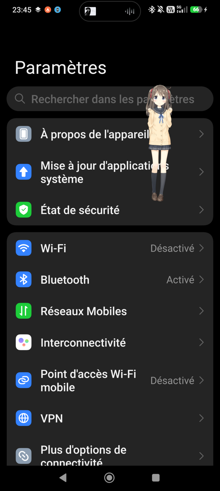

# Fox Girl Supremacy

> Idée de 3h du mat. Je l'ai commencée, elle marche, j'ai arrêté. Voilà, c'est
> tout. Abandonné.

**Le pitch :** une renarde qui vit **par-dessus** tes autres apps. Elle se balade
en bas de l'écran, tu la caresses, tu lui files à bouffer, elle raconte sa vie
dans une bulle. Peu importe l'app ouverte, elle est là.

**En vrai :** c'est pas une renarde. C'est un modèle [Live2D](https://www.live2d.com/)
posé dans un overlay système, qui respire, cligne des yeux, marche de gauche à
droite et joue une anim quand tu le touches. La « personnalité », les humeurs, la
vie en fond — jamais faites. Le modèle livré par défaut, c'est Hiyori (un sample
Live2D), pas même un renard. Donc à ce stade c'est un moteur de compagnon Live2D
générique avec un nom ambitieux, pas la renarde du pitch.

Techniquement quand même : overlay système, service au premier plan pour survivre
au changement d'app, rendu Live2D en natif Android.

## Aperçu

<p align="center">
  
</p>

Par-dessus n'importe quelle app — là elle squatte la calculatrice, l'horloge et les réglages :

<p align="center">
  
  
  
</p>

| Menu radial (appui long) | Écran de contrôle |
|:---:|:---:|
|  |  |

> Modèle par défaut : Hiyori (sample officiel Live2D). Oui, c'est censé être une
> renarde. Non, ce n'en est pas une. Voir plus bas.

## Face tracking (nouveau)

Dans **Comportement → Face tracking**, active la caméra frontale. L'application
utilise CameraX et ML Kit en local pour suivre l'orientation de la tête, la
position du visage, l'ouverture des yeux et le sourire, puis applique ces valeurs
aux paramètres standard du modèle Cubism (`ParamAngleX/Y/Z`, `ParamEyeLOpen`,
`ParamEyeROpen`, `ParamEyeBallX/Y`, `ParamMouthForm`). Les images ne sont ni
sauvegardées ni envoyées à un serveur. Le suivi fonctionne seulement si le modèle
expose ces paramètres; le sourire est utilisé comme forme de bouche, pas comme
mesure fiable de l'ouverture de la mâchoire.

La caméra est facultative : sans autorisation, le compagnon continue à fonctionner
sans suivi. Le suivi s'arrête quand on désactive le commutateur ou le service.

## Ce que ça fait (oui, ça tourne)

- Overlay par-dessus n'importe quelle app (`SYSTEM_ALERT_WINDOW`).
- Rendu Live2D avec respiration et clignement procéduraux — marche sur n'importe
  quel modèle, même ceux qui n'ont aucune animation fournie.
- Elle déambule toute seule (une state machine repos ↔ marche, rien de plus).
- Appui long → menu radial : caresser, nourrir, parler.
- Mode câlin, snack qu'on lâche depuis la notif, bavardage spontané.
- Import de tes propres modèles, sélecteur de modèle, écran de réglages Material 3.

## Ce que ça ne fait pas

- La « vie en fond » (faim/affection qui dérivent, réactions quand tu l'ignores)
  était prévue. Jamais faite. Voir [DESIGN.md](DESIGN.md) si tu veux reprendre.
- iOS. Impossible — iOS interdit de dessiner par-dessus les autres apps. C'était
  tout le concept, donc c'est Android ou rien.
- Être fini.

## Si tu veux quand même le lancer

Il te faut un JDK 17+, Android Studio, Android SDK Platform 35, NDK 26.3.11579264 et CMake 3.22.1.

Cette branche utilise maintenant le **Cubism SDK for Native 5 R5** via JNI (C++/OpenGL ES 2). Le framework et les bibliothèques Core Android fournis dans le SDK envoyé sont placés sous `CubismSdkForNative-5-r.5/`. Le projet est configuré pour `arm64-v8a` et `x86_64`.

Pour compiler :

```bash
./gradlew assembleDebug
```

Le modèle Hiyori est dans `app/src/main/assets/live2d/hiyori/`. Tu peux aussi importer tes propres modèles depuis l'application. Les fichiers du SDK Live2D gardent leurs licences et notices dans `CubismSdkForNative-5-r.5/`.

**État de cette livraison :** le pont JNI, le renderer natif, le passage des données de face tracking et la configuration CMake/Gradle ont été préparés. L'APK n'a pas pu être compilé dans l'environnement de packaging car la distribution Gradle 8.14.3 n'a pas pu être téléchargée et qu'aucun Android SDK/NDK n'est installé dans cet environnement. Consultez [NATIVE_CUBISM_SETUP.md](NATIVE_CUBISM_SETUP.md) et [BUILD_STATUS.txt](BUILD_STATUS.txt) avant de compiler.

## Les deux ou trois pièges qui m'ont coûté une soirée

- **Notification permanente.** Android l'impose pour tout service au premier plan.
  Tu peux pas la cacher. Fais-en une feature, pas une nuisance.
- **Les OEM qui butent les services.** Xiaomi, Oppo & co tuent ce genre de service
  en arrière-plan sans prévenir. La fiabilité dépend du tel.
- Le reste (ANR de la SurfaceView, gestion des touches de l'overlay, shaders
  Live2D qui plantent au 2e modèle...) est raconté dans [DESIGN.md](DESIGN.md).

## Licence

Code sous MIT — voir [LICENSE](LICENSE). Fais-en ce que tu veux.

Les trucs pas à moi gardent leur licence :
- **Live2D Cubism SDK for Native 5 R5** — © Live2D Inc. Utilisé selon les termes et notices fournis dans `CubismSdkForNative-5-r.5/`.
- **Modèle Hiyori** — sample officiel Live2D, utilisé selon leurs conditions.
