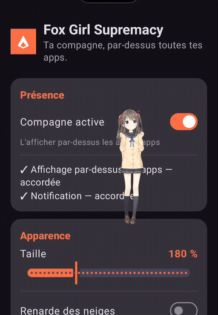
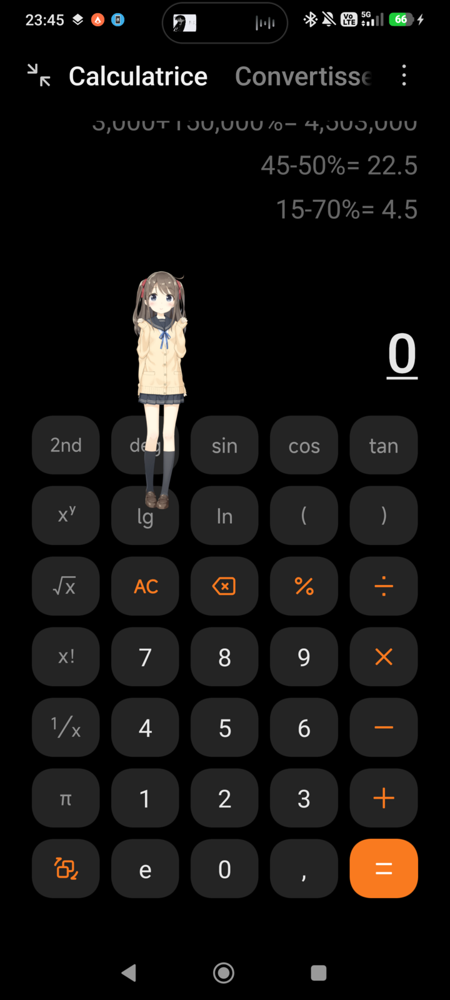
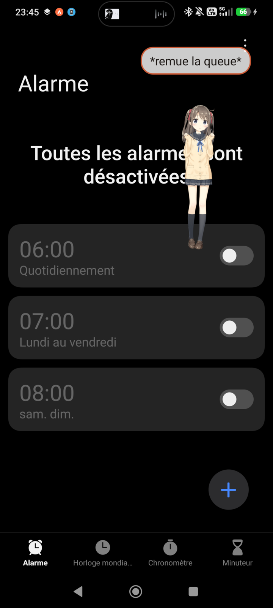
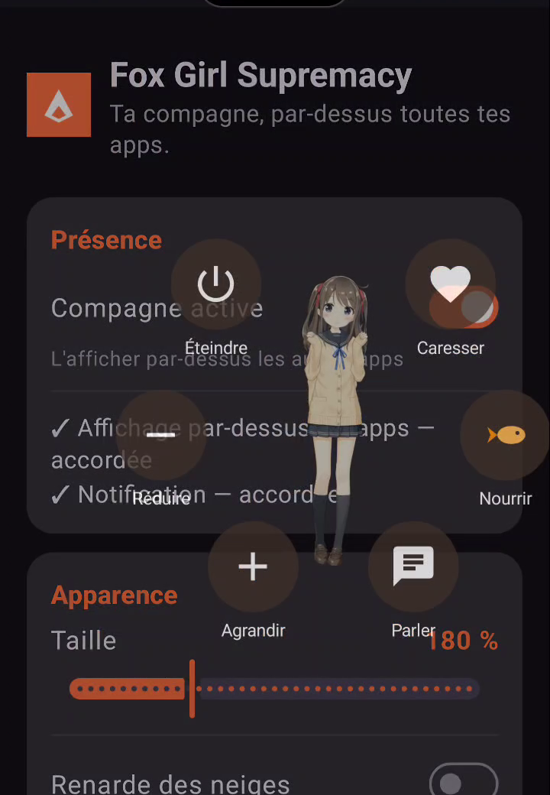
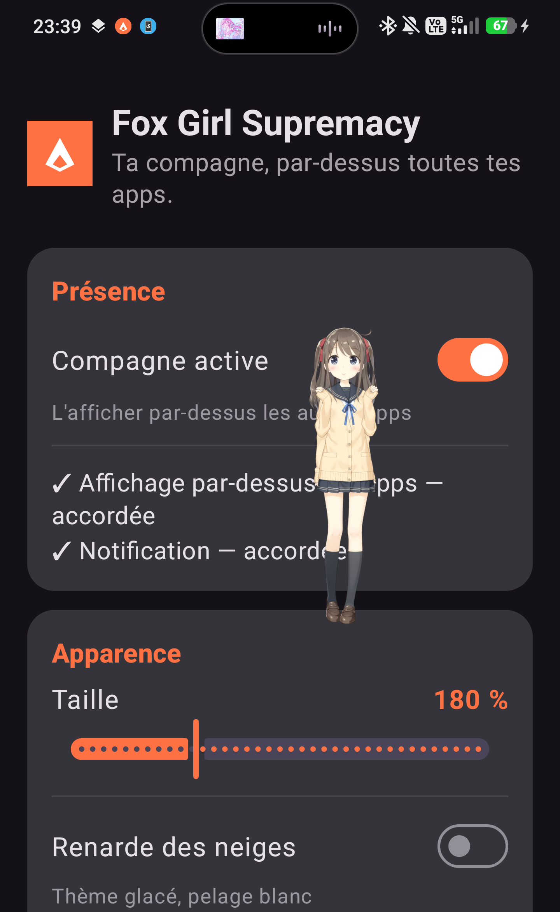

# Fox Girl Supremacy

> Idée de 3h du mat. Je l'ai commencée, elle marche, j'ai arrêté. Voilà, c'est
> tout. Abandonné.

**Le pitch :** une renarde qui vit **par-dessus** tes autres apps. Elle se balade
en bas de l'écran, tu la caresses, tu lui files à bouffer, elle raconte sa vie
dans une bulle. Peu importe l'app ouverte, elle est là.

**En vrai :** c'est pas une renarde. C'est un modèle [Live2D](https://www.live2d.com/)
posé dans un overlay système, qui respire, cligne des yeux, marche de gauche à
droite et joue une anim quand tu le touches. La « personnalité », les humeurs, la
vie en fond — jamais faites. Le modèle livré par défaut, c'est Hiyori (un sample
Live2D), pas même un renard. Donc à ce stade c'est un moteur de compagnon Live2D
générique avec un nom ambitieux, pas la renarde du pitch.

Techniquement quand même : overlay système, service au premier plan pour survivre
au changement d'app, rendu Live2D en natif Android.

## Aperçu

<p align="center">
  
</p>

Par-dessus n'importe quelle app — là elle squatte la calculatrice, l'horloge et les réglages :

<p align="center">
  
  
  
</p>

| Menu radial (appui long) | Écran de contrôle |
|:---:|:---:|
|  |  |

> Modèle par défaut : Hiyori (sample officiel Live2D). Oui, c'est censé être une
> renarde. Non, ce n'en est pas une. Voir plus bas.

## Ce que ça fait (oui, ça tourne)

- Overlay par-dessus n'importe quelle app (`SYSTEM_ALERT_WINDOW`).
- Rendu Live2D avec respiration et clignement procéduraux — marche sur n'importe
  quel modèle, même ceux qui n'ont aucune animation fournie.
- Elle déambule toute seule (une state machine repos ↔ marche, rien de plus).
- Appui long → menu radial : caresser, nourrir, parler.
- Mode câlin, snack qu'on lâche depuis la notif, bavardage spontané.
- Import de tes propres modèles, sélecteur de modèle, écran de réglages Material 3.

## Ce que ça ne fait pas

- La « vie en fond » (faim/affection qui dérivent, réactions quand tu l'ignores)
  était prévue. Jamais faite. Voir [DESIGN.md](DESIGN.md) si tu veux reprendre.
- iOS. Impossible — iOS interdit de dessiner par-dessus les autres apps. C'était
  tout le concept, donc c'est Android ou rien.
- Être fini.

## Si tu veux quand même le lancer

Il te faut un JDK 17, Android Studio (AGP 8.7) et un tel/émulateur Android 8.0+.

Deux morceaux ne sont **pas** dans le repo — pas par flemme, par licence :

**1. Le SDK Live2D.** Propriétaire, pas redistribuable. Tu le récupères toi-même
sur <https://www.live2d.com/en/sdk/download/native/> (Cubism SDK for Java), tu le
décompresses et tu le poses à la racine dans `CubismSdkForJava-5-r.5/`. Le projet
attend le Framework dans `.../Framework/framework` et le Core dans
`.../Core/android/Live2DCubismCore.aar`.

**2. Un modèle.** Il y en a déjà un : **Hiyori**, l'échantillon officiel Live2D
(celui-là a le droit d'être redistribué), dans
`app/src/main/assets/live2d/hiyori/`. Donc ça build direct. Tu veux le tien ? Tu
le poses dans `app/src/main/assets/live2d/<id>/` (faut un `*.model3.json` dedans),
ou tu l'importes depuis l'app.

> ⚠️ Beaucoup de modèles Live2D « gratuits » sont **usage perso, pas de
> redistribution**. N'ajoute au dépôt que ce que tu as le droit de partager. La
> version publique de ce repo tourne exprès sur un modèle sample propre.

Puis :

```
./gradlew assembleDebug
```

Au premier lancement elle te demande l'autorisation « Affichage par-dessus les
autres apps » (elle t'envoie dans les réglages système) et la permission de notif.

## Les deux ou trois pièges qui m'ont coûté une soirée

- **Notification permanente.** Android l'impose pour tout service au premier plan.
  Tu peux pas la cacher. Fais-en une feature, pas une nuisance.
- **Les OEM qui butent les services.** Xiaomi, Oppo & co tuent ce genre de service
  en arrière-plan sans prévenir. La fiabilité dépend du tel.
- Le reste (ANR de la SurfaceView, gestion des touches de l'overlay, shaders
  Live2D qui plantent au 2e modèle...) est raconté dans [DESIGN.md](DESIGN.md).

## Licence

Code sous MIT — voir [LICENSE](LICENSE). Fais-en ce que tu veux.

Les trucs pas à moi gardent leur licence :
- **Live2D Cubism SDK** — © Live2D Inc. Pas inclus, à télécharger toi-même.
- **Modèle Hiyori** — sample officiel Live2D, utilisé selon leurs conditions.
